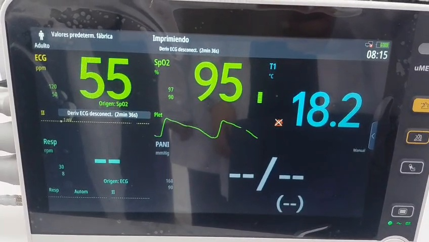
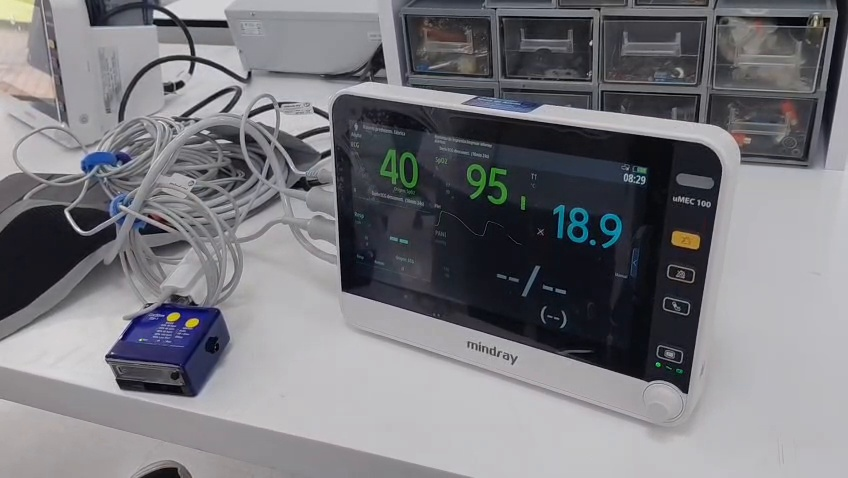
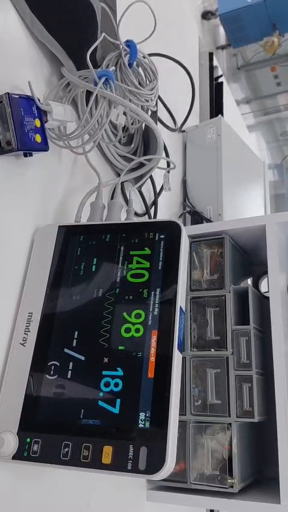
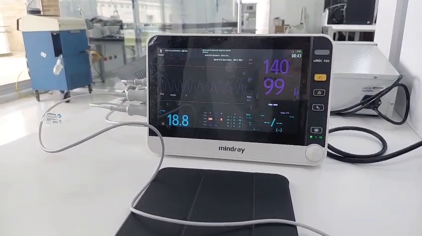

# Laboratorio 5 — Simulación y monitoreo de variables cardiovasculares y hemodinámicas

## 1. Resumen

Se efectuó una evaluación funcional del módulo de pulsioximetría del monitor Mindray uMEC 100 utilizando el simulador Pronk OxSim OX-1. Se consideraron cuatro condiciones: bradicardia (40 bpm, SpO₂ 95 %), hipoxemia (80 bpm, SpO₂ 85 %), saturación alta con baja perfusión (80 bpm, SpO₂ 99 %) y taquicardia (140 bpm, SpO₂ 98 %). Se compararon las consignas del simulador con las lecturas registradas, se calcularon errores absolutos y relativos y se examinó la respuesta de las alarmas. Los registros aportados indican tiempos de activación de entre 8 y 12 segundos; su sincronización exacta con los cambios de consigna no pudo corroborarse de forma independiente. Las conclusiones se limitan a la evaluación funcional realizada, sin afirmar calibración ni conformidad metrológica.

## 2. Introducción

La pulsioximetría estima la saturación periférica de oxígeno (SpO₂) mediante el análisis de la absorción de luz roja e infrarroja por la hemoglobina. La componente pulsátil permite estimar la frecuencia de pulso (PR) y representar una onda fotopletismográfica (PPG). Un simulador de pulsioximetría permite reproducir condiciones controladas sin conectar el sensor a un paciente. La lectura obtenida depende del simulador, la compatibilidad con el sensor, la configuración del monitor, la calidad de la señal y el procesamiento interno. En esta práctica se evaluó la respuesta del uMEC 100 frente a cambios de saturación y frecuencia de pulso, así como la activación de alarmas configuradas [1, 2].

## 3. Objetivos

**General.** Operar el simulador Pronk OxSim OX-1 y el monitor Mindray uMEC 100 para efectuar pruebas funcionales del módulo de SpO₂.

**Específicos.**

1. Identificar las variables y condiciones simuladas por el OxSim OX-1.
2. Comparar los valores simulados de SpO₂ y PR con las lecturas del uMEC 100.
3. Calcular los errores absolutos y relativos de medición.
4. Comprobar el comportamiento de las alarmas frente a los límites configurados.
5. Relacionar la frecuencia de pulso y la perfusión con la onda PPG e identificar las limitaciones de la prueba.

## 4. Materiales y seguridad

- 1 monitor Mindray uMEC 100 con sensor de SpO₂.
- 1 simulador Pronk OxSim OX-1.
- Computador o dispositivo para documentar la práctica y capturas del monitor.

## 5. Parte A — Revisión técnica

### 5.1. Monitor Mindray uMEC 100

Monitor multiparamétrico que permite visualizar parámetros fisiológicos y configurar límites de alarma. En esta práctica se utilizó únicamente la medición de **SpO₂** y **frecuencia de pulso derivada del sensor óptico**. La PR obtenida de pulsioximetría no debe confundirse con la HR medida mediante ECG, aunque puedan coincidir numéricamente [3].

### 5.2. Simulador Pronk OxSim OX-1

Simulador destinado a comprobar el funcionamiento de sistemas de pulsioximetría mediante condiciones ópticas/pulsátiles reproducibles [4]. Las variables abordadas en esta práctica fueron:

<table align="center">
  <thead>
    <tr>
      <th align="center">Variable</th>
      <th align="center">Descripción</th>
      <th align="center">Unidad</th>
    </tr>
  </thead>
  <tbody>
    <tr>
      <td align="center">SpO₂ simulada</td>
      <td align="center">Saturación periférica de oxígeno nominal que debe estimar el monitor.</td>
      <td align="center">%</td>
    </tr>
    <tr>
      <td align="center">Frecuencia de pulso (PR)</td>
      <td align="center">Número de pulsaciones simuladas por minuto.</td>
      <td align="center">bpm</td>
    </tr>
    <tr>
      <td align="center">Condición de perfusión</td>
      <td align="center">Modificación de la amplitud o intensidad pulsátil, según la capacidad y modo del simulador.</td>
      <td align="center">Modo/índice del equipo</td>
    </tr>
  </tbody>
</table>

### 5.3. ¿Cómo se coloca el uMEC 100 en modo monitor?

1. Con supervisión del técnico, encender el monitor.
2. Verificar que se encuentra en la pantalla de monitorización y que el módulo de SpO₂ está habilitado.
3. Conectar el sensor de SpO₂ al monitor y acoplarlo correctamente al simulador.
4. Revisar los valores mostrados y los límites de alarma antes de iniciar las pruebas.
5. Esperar la estabilización de la lectura antes de registrarla.

### 5.4. Tolerancias o errores máximos permitidos (EMP)

Los errores observados en esta práctica no equivalen automáticamente a un resultado de conformidad. La especificación aplicable debe verificarse para el **monitor, el módulo y el sensor exactos**. La precisión de SpO₂ suele expresarse mediante **Arms**, medida estadística que no equivale a un error máximo permitido por lectura individual. La precisión de PR y el comportamiento en baja perfusión también dependen de las especificaciones del fabricante. Como marco normativo general puede consultarse ISO 80601-2-61 [2]; las especificaciones del conjunto monitor-sensor deben contrastarse con la documentación del fabricante [3].

<table align="center">
  <thead>
    <tr>
      <th align="center">Parámetro</th>
      <th align="center">Criterio de evaluación</th>
      <th align="center">Especificación aplicable al equipo probado</th>
    </tr>
  </thead>
  <tbody>
    <tr>
      <td align="center">SpO₂</td>
      <td align="center">Exactitud declarada, rango de medición y condiciones de prueba</td>
      <td align="center">Según especificación técnica del conjunto monitor-sensor.</td>
    </tr>
    <tr>
      <td align="center">PR</td>
      <td align="center">Exactitud declarada en bpm o porcentaje y rango de medición</td>
      <td align="center">Según especificación técnica del conjunto monitor-sensor.</td>
    </tr>
    <tr>
      <td align="center">Baja perfusión</td>
      <td align="center">Desempeño y límites de funcionamiento declarados</td>
      <td align="center">Según condiciones de funcionamiento del monitor y simulador.</td>
    </tr>
  </tbody>
</table>

Los errores observados se presentan como resultados funcionales de la práctica y no como certificación metrológica.

## 6. Parte B — Procedimiento experimental

1. Se preparó el monitor uMEC 100 y se verificó su pantalla de monitorización.
2. Se conectó el sensor de pulsioximetría al simulador OxSim OX-1.
3. Se estableció la condición de bradicardia: **40 bpm y SpO₂ 95 %**; se registraron los valores y la onda PPG.
4. Se ajustó el límite inferior de SpO₂ a **90 %**.
5. Se estableció la condición de hipoxemia: **80 bpm y SpO₂ 85 %**; se observó la respuesta de alarma, incluyendo su estado a los cinco segundos cuando fue posible.
6. Se ajustó el límite superior de SpO₂ a **97 %**.
7. Se estableció una consigna de **SpO₂ 99 %** bajo la condición denominada *Low Perfusion* y se observó la lectura y la PPG. La activación efectiva de dicho modo requiere evidencia de la pantalla del simulador.
8. Se estableció la condición de taquicardia: **140 bpm y SpO₂ 98 %**; se examinó la onda y la respuesta de alarma de frecuencia elevada.
9. Se organizaron las lecturas disponibles, los límites de alarma y los tiempos de activación consignados en el registro experimental.
10. Se calcularon los errores y se interpretaron los resultados, distinguiendo lecturas estabilizadas de transitorios.

### 6.1. Lecturas registradas

<table align="center">
  <thead>
    <tr>
      <th align="center">Escenario</th>
      <th align="center">Consigna PR</th>
      <th align="center">Consigna SpO₂</th>
      <th align="center">PR monitor</th>
      <th align="center">SpO₂ monitor</th>
      <th align="center">Observación</th>
    </tr>
  </thead>
  <tbody>
    <tr>
      <td align="center">Bradicardia</td>
      <td align="center">40 bpm</td>
      <td align="center">95 %</td>
      <td align="center">40 bpm</td>
      <td align="center">95 %</td>
      <td align="center">Coincidencia de las lecturas registradas.</td>
    </tr>
    <tr>
      <td align="center">Hipoxemia</td>
      <td align="center">80 bpm</td>
      <td align="center">85 %</td>
      <td align="center">80 bpm</td>
      <td align="center">85 %</td>
      <td align="center">Coincidencia puntual.</td>
    </tr>
    <tr>
      <td align="center">Baja perfusión</td>
      <td align="center">80 bpm</td>
      <td align="center">99 %</td>
      <td align="center">80 bpm</td>
      <td align="center">100 %</td>
      <td align="center">La diferencia es de 1 punto porcentual si la captura corresponde a la misma consigna estabilizada.</td>
    </tr>
    <tr>
      <td align="center">Taquicardia</td>
      <td align="center">140 bpm</td>
      <td align="center">98 %</td>
      <td align="center">140 bpm</td>
      <td align="center">99 %</td>
      <td align="center">Diferencia de 1 punto porcentual de SpO₂.</td>
    </tr>
  </tbody>
</table>

### 6.2. Tabla de verificación de alarmas

Los tiempos de activación registrados permiten comparar la respuesta del monitor en los cuatro escenarios.

<table align="center">
  <thead>
    <tr>
      <th align="center">Escenario</th>
      <th align="center">SpO₂ inferior</th>
      <th align="center">SpO₂ superior</th>
      <th align="center">PR inferior/superior</th>
      <th align="center">Consigna PR / SpO₂</th>
      <th align="center">Alarma esperada por umbral</th>
      <th align="center">Tiempo de activación</th>
    </tr>
  </thead>
  <tbody>
    <tr>
      <td align="center">Bradicardia</td>
      <td align="center">90 %</td>
      <td align="center">100 %</td>
      <td align="center">50 / 110 bpm</td>
      <td align="center">40 bpm / 95 %</td>
      <td align="center">PR baja</td>
      <td align="center">12 s</td>
    </tr>
    <tr>
      <td align="center">Hipoxemia</td>
      <td align="center">90 %</td>
      <td align="center">100 %</td>
      <td align="center">50 / 110 bpm</td>
      <td align="center">80 bpm / 85 %</td>
      <td align="center">SpO₂ baja</td>
      <td align="center">8 s</td>
    </tr>
    <tr>
      <td align="center">Baja perfusión</td>
      <td align="center">90 %</td>
      <td align="center">97 %</td>
      <td align="center">50 / 110 bpm</td>
      <td align="center">80 bpm / 99 %</td>
      <td align="center">SpO₂ alta</td>
      <td align="center">12 s</td>
    </tr>
    <tr>
      <td align="center">Taquicardia</td>
      <td align="center">90 %</td>
      <td align="center">97 %</td>
      <td align="center">50 / 110 bpm</td>
      <td align="center">140 bpm / 98 %</td>
      <td align="center">PR alta y SpO₂ alta</td>
      <td align="center">10 s</td>
    </tr>
  </tbody>
</table>

### 6.3. Errores absolutos y relativos

Para una consigna simulada $x_s$ y una lectura del monitor $x_m$:

- **Error absoluto:** $E_a=|x_m-x_s|$.
- **Error relativo porcentual:** $E_r=(E_a/|x_s|)\times100$, para $x_s\neq0$.

El error absoluto de SpO₂ se expresa en **puntos porcentuales (pp)**; el de PR, en **bpm**.

<table align="center">
  <thead>
    <tr>
      <th align="center">Escenario</th>
      <th align="center">Variable</th>
      <th align="center">Simulador</th>
      <th align="center">Monitor</th>
      <th align="center">Error absoluto</th>
      <th align="center">Error relativo</th>
    </tr>
  </thead>
  <tbody>
    <tr>
      <td align="center">Bradicardia</td>
      <td align="center">SpO₂</td>
      <td align="center">95 %</td>
      <td align="center">95 %</td>
      <td align="center">0 pp</td>
      <td align="center">0,00 %</td>
    </tr>
    <tr>
      <td align="center">Bradicardia</td>
      <td align="center">PR</td>
      <td align="center">40 bpm</td>
      <td align="center">40 bpm</td>
      <td align="center">0 bpm</td>
      <td align="center">0,00 %</td>
    </tr>
    <tr>
      <td align="center">Hipoxemia</td>
      <td align="center">SpO₂</td>
      <td align="center">85 %</td>
      <td align="center">85 %</td>
      <td align="center">0 pp</td>
      <td align="center">0,00 %</td>
    </tr>
    <tr>
      <td align="center">Hipoxemia</td>
      <td align="center">PR</td>
      <td align="center">80 bpm</td>
      <td align="center">80 bpm</td>
      <td align="center">0 bpm</td>
      <td align="center">0,00 %</td>
    </tr>
    <tr>
      <td align="center">Baja perfusión</td>
      <td align="center">SpO₂</td>
      <td align="center">99 %</td>
      <td align="center">100 %</td>
      <td align="center">1 pp</td>
      <td align="center">1,01 %</td>
    </tr>
    <tr>
      <td align="center">Baja perfusión</td>
      <td align="center">PR</td>
      <td align="center">80 bpm</td>
      <td align="center">80 bpm</td>
      <td align="center">0 bpm</td>
      <td align="center">0,00 %</td>
    </tr>
    <tr>
      <td align="center">Taquicardia</td>
      <td align="center">SpO₂</td>
      <td align="center">98 %</td>
      <td align="center">99 %</td>
      <td align="center">1 pp</td>
      <td align="center">1,02 %</td>
    </tr>
    <tr>
      <td align="center">Taquicardia</td>
      <td align="center">PR</td>
      <td align="center">140 bpm</td>
      <td align="center">140 bpm</td>
      <td align="center">0 bpm</td>
      <td align="center">0,00 %</td>
    </tr>
  </tbody>
</table>

**Ejemplo de cálculo (taquicardia, SpO₂):** $E_a=|99-98|=1\,pp$; $E_r=(1/98)\times100\approx1,02\%$.

### 6.4. Registro de la señal fotopletismográfica (PPG)

La PPG refleja las variaciones pulsátiles de la absorción óptica. Su periodo teórico depende de la frecuencia de pulso: $T=60/PR$.

<table align="center">
  <thead>
    <tr>
      <th align="center">Escenario</th>
      <th align="center">PR</th>
      <th align="center">Periodo teórico</th>
      <th align="center">Interpretación</th>
    </tr>
  </thead>
  <tbody>
    <tr>
      <td align="center">Bradicardia</td>
      <td align="center">40 bpm</td>
      <td align="center">1,50 s</td>
      <td align="center">Picos más separados temporalmente.</td>
    </tr>
    <tr>
      <td align="center">Hipoxemia</td>
      <td align="center">80 bpm</td>
      <td align="center">0,75 s</td>
      <td align="center">Separación temporal intermedia.</td>
    </tr>
    <tr>
      <td align="center">Baja perfusión</td>
      <td align="center">80 bpm</td>
      <td align="center">0,75 s</td>
      <td align="center">Una amplitud pulsátil reducida puede dificultar la detección; no se confirma distorsión concreta sin evidencia ampliada.</td>
    </tr>
    <tr>
      <td align="center">Taquicardia</td>
      <td align="center">140 bpm</td>
      <td align="center">0,43 s</td>
      <td align="center">Picos más próximos temporalmente.</td>
    </tr>
  </tbody>
</table>

**¿Se distorsionó la onda con baja perfusión?** No puede concluirse de manera inequívoca con las capturas descritas. Se requiere una comparación visual de la PPG con y sin el modo de baja perfusión, a escala temporal y amplitud comparables. Una baja perfusión puede reducir la amplitud y aumentar la susceptibilidad al ruido, pero no demuestra por sí sola que se haya producido una distorsión visible en esta prueba.

**Evidencias a incorporar al repositorio:**

- `evidencias/bradicardia.png`: pantalla con PR y SpO₂ estabilizadas y PPG visible.
- `evidencias/hipoxemia.png`: pantalla con valores y alarma.
- `evidencias/baja_perfusion.png`: pantalla del monitor; idealmente, captura adicional del simulador que confirme *Low Perfusion*.
- `evidencias/taquicardia.png`: pantalla con PR, SpO₂ y PPG.

> Los nombres anteriores son **rutas sugeridas**. No deben incluirse como enlaces de imagen hasta que existan realmente los archivos.

## 7. Parte C — Análisis de resultados

### 7.1. Diferencias entre valores simulados y medidos

En los cuatro escenarios consignados, la frecuencia de pulso del monitor coincide numéricamente con la consigna del simulador, por lo que los errores absolutos tabulados de PR son 0 bpm. Para SpO₂, la hipoxemia presenta una coincidencia puntual; la baja perfusión y la taquicardia presentan diferencias de 1 pp. En bradicardia, la lectura de 95 % coincide con la consigna.

Como estadística descriptiva **condicionada a la tabla**, el promedio de error absoluto de PR es **0 bpm**. Para SpO₂, el promedio de error absoluto es **0,50 pp**. Estos promedios describen únicamente cuatro condiciones distintas; **no representan repetibilidad, precisión clínica ni Arms**, ya que no se dispone de suficientes repeticiones ni de una referencia independiente.

### 7.2. Respuesta de las alarmas

Los valores consignados de activación son 12 s (bradicardia), 8 s (hipoxemia), 12 s (baja perfusión) y 10 s (taquicardia). Su promedio aritmético es **10,5 s** y el rango es **8–12 s**. Los tiempos se presentan como registros de activación del sistema de alarmas. Una alarma puede presentar retardos de detección, procesamiento y configuración, pero estos mecanismos no se cuantificaron por separado.

### 7.3. Relación entre PPG, frecuencia de pulso y SpO₂

La frecuencia de pulso es inversamente proporcional al intervalo temporal entre picos de la PPG. A 40 bpm se espera un pulso cada 1,50 s, mientras que a 140 bpm se espera aproximadamente uno cada 0,43 s. La SpO₂ no se calcula a partir de la distancia entre picos, sino de la relación de las componentes ópticas roja e infrarroja. Por ello, dos señales pueden tener igual frecuencia de pulso y diferente saturación. Una perfusión baja puede reducir la calidad de la señal y generar lecturas menos estables.

### 7.4. Limitaciones de la evaluación

- Los errores de medición se analizaron de forma descriptiva, sin establecer conformidad metrológica.
- No se contó con un patrón de referencia independiente ni con repeticiones suficientes para estimar incertidumbre o repetibilidad.
- No se documentó de forma inequívoca la configuración *Low Perfusion* en el simulador.
- Los registros disponibles no permiten confirmar simultáneamente el instante exacto de cambio de consigna y el inicio de cada alarma.
- Las capturas de PPG no permiten cuantificar distorsión morfológica o amplitud sin escalas y condiciones comparables.

## 8. Preguntas para la discusión

### 8.1. ¿Cuál es el principio de operación del Pronk OxSim OX-1 para simular una onda pulsátil?

El principio físico se basa en reproducir ante el sensor las variaciones periódicas de la señal óptica que normalmente produciría la sangre arterial pulsátil. Un pulsioxímetro emite luz roja e infrarroja y detecta la luz recibida; la proporción entre las componentes pulsátiles y no pulsátiles de ambas longitudes de onda permite estimar la SpO₂, mientras que la periodicidad de la señal permite calcular la frecuencia de pulso. El OxSim OX-1 simula una respuesta óptica compatible con valores programados de saturación y pulso, de manera que el sensor detecta cambios equivalentes a los de un tejido perfundido y el monitor presenta lecturas de SpO₂, PR y una onda PPG sin necesidad de un paciente [2, 4]. Esta explicación describe el principio de simulación; el mecanismo óptico interno exacto del OX-1 requiere confirmación en su manual técnico.

### 8.2. ¿Por qué una SpO₂ baja puede ser un falso positivo en una situación de mala perfusión?

La perfusión periférica reducida disminuye la amplitud de la componente pulsátil de la señal, lo que puede reducir su relación señal-ruido [2]. El movimiento, la luz ambiente o un acoplamiento inadecuado del sensor pueden producir lecturas inestables o falsamente bajas y activar una alarma sin una desaturación real. Sin embargo, una lectura baja también puede ser verdadera y no debe descartarse automáticamente: deben evaluarse la calidad de la señal, el sensor y el contexto clínico.

## Conclusiones

La evaluación funcional del Mindray uMEC 100 con el simulador Pronk OxSim OX-1 mostró coincidencia en las frecuencias de pulso registradas (error absoluto de 0 bpm) y diferencias de SpO₂ de hasta 1 punto porcentual (error relativo máximo de 1,02 %). Las alarmas presentaron tiempos de activación registrados entre 8 y 12 segundos. La práctica permitió relacionar la frecuencia de pulso con la onda PPG e identificar posibles efectos de la perfusión sobre la calidad de la señal. Estos resultados describen únicamente las condiciones ensayadas y no constituyen una certificación de precisión clínica o conformidad metrológica; para ampliar la evaluación se requieren repeticiones y registros comparables de la señal.

## Referencias y fuentes

[1] Universidad Militar Nueva Granada. Guía de preparación, práctica de laboratorio: Simulación y Monitoreo de Variables Cardiovasculares y Hemodinámicas, revisión 3, 2025.

[2] ISO 80601-2-61, Medical electrical equipment — Particular requirements for basic safety and essential performance of pulse oximeter equipment (referencia normativa general; verificar edición vigente).

[3] Manual de operación y especificaciones Mindray uMEC 100, pendiente de adjuntar/validar edición y configuración de sensor.

[4] Manual/ficha técnica Pronk OxSim OX-1, pendiente de adjuntar/validar edición.

## Anexo: evidencias visuales

## Evidencias disponibles de la práctica

Se presentan los valores observados y los registros experimentales de los cuatro escenarios evaluados.

### Evidencia 1. Bradicardia

- Condición programada: **40 bpm y SpO₂ de 95 %**.
- Lectura observada en el registro de video descrito: **40 bpm y SpO₂ de 95 %**.
- Resultado: coincidencia puntual de frecuencia y saturación en esa observación.

### Evidencia 2. Hipoxemia

- Condición programada: **80 bpm y SpO₂ de 85 %**.
- Lectura observada en el registro de video descrito: **80 bpm y SpO₂ de 85 %**.
- Resultado: coincidencia puntual de ambas variables.

### Evidencia 3. Saturación elevada / condición de baja perfusión

- Condición programada: **SpO₂ de 99 %**, con modo *Low Perfusion* indicado en el procedimiento.
- Lectura observada en el registro de video descrito: **80 bpm y SpO₂ de 100 %**.
- Resultado: diferencia de 1 punto porcentual de SpO₂ respecto de la consigna indicada.
- Limitación: la pantalla del monitor por sí sola no confirma que el modo *Low Perfusion* estuviera activado.

### Evidencia 4. Taquicardia

- Condición programada: **140 bpm y SpO₂ de 98 %**.
- Lectura observada en el registro de video descrito: **140 bpm y SpO₂ de 99 %**.
- Resultado: coincidencia puntual en frecuencia y diferencia de 1 punto porcentual en SpO₂, en el registro presentado.

### Evidencia 5. Registro de alarmas

<table align="center">
  <thead>
    <tr>
      <th align="center">Escenario</th>
      <th align="center">Límite relevante</th>
      <th align="center">Tiempo de activación registrado</th>
    </tr>
  </thead>
  <tbody>
    <tr>
      <td align="center">Bradicardia</td>
      <td align="center">PR inferior: 50 bpm</td>
      <td align="center">12 s</td>
    </tr>
    <tr>
      <td align="center">Hipoxemia</td>
      <td align="center">SpO₂ inferior: 90 %</td>
      <td align="center">8 s</td>
    </tr>
    <tr>
      <td align="center">Saturación alta / baja perfusión</td>
      <td align="center">SpO₂ superior: 97 %</td>
      <td align="center">12 s</td>
    </tr>
    <tr>
      <td align="center">Taquicardia</td>
      <td align="center">PR superior: 110 bpm</td>
      <td align="center">10 s</td>
    </tr>
  </tbody>
</table>
